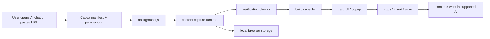

# Capsa

Capsa is a browser extension that helps you save useful AI conversation context, compress it into a portable capsule, and continue the work on another supported AI chat without manually rebuilding everything from memory.

It is designed for the common workflow where a long discussion, design decision, code draft, or research thread is spread across a single chat session or between separate chat tools. Capsa reads the accessible chat content in the browser, validates what it can safely capture, and turns it into a compact text package that can be copied, saved, or inserted into a supported destination.

## Table of contents

- [Problem statement](#problem-statement)
- [Features](#features)
- [How Capsa works](#how-capsa-works)
- [Architecture and data flow](#architecture-and-data-flow)
- [Technology stack](#technology-stack)
- [Prerequisites](#prerequisites)
- [Installation for end users](#installation-for-end-users)
- [Developer setup](#developer-setup)
- [Usage guide](#usage-guide)
- [Configuration and permissions](#configuration-and-permissions)
- [Testing and verification](#testing-and-verification)
- [Troubleshooting and limitations](#troubleshooting-and-limitations)
- [Security and privacy](#security-and-privacy)
- [Contributing](#contributing)
- [Roadmap](#roadmap)
- [License and acknowledgements](#license-and-acknowledgements)

## Problem statement

AI chats are useful, but they are not always easy to move between sessions, tabs, or tools. A user may hit usage limits, switch from one provider to another, or lose context when a conversation is no longer visible or the current interface is not convenient for continuing the task.

Capsa addresses that problem by making capture and handoff explicit and transparent. It does not promise to recover hidden or unavailable platform data, and it intentionally refuses to produce a capsule when the chat cannot be verified. The extension focuses on the content that is actually accessible in the browser and the supported AI sites it deliberately supports.

## Features

- Verified whole-chat capture for supported AI pages
  - Capsa reads the visible conversation history, follows lazy-loading behavior, and only creates a capsule after independent verification checks agree.
- Link-based capture
  - Paste a supported chat URL and Capsa opens it in a hidden or visible tab, captures it, and closes the page when the work is done.
- Capsule generation and size modes
  - The generated result can be rendered in compact, standard, extended, smart, and full modes depending on the user’s needs and token budget.
- File and folder import safety
  - Text, code, and archive content can be added to the same capsule, while secret-like files, build output, and unsafe paths are skipped or flagged.
- Copy, insert, and export flows
  - The final capsule can be copied to the clipboard, inserted into the active chat textbox, or saved as a Markdown file.
- Local-only processing
  - Capsa stores its working state in the browser and operates without a separate backend service.
- Fallback handling for incomplete reads
  - If the conversation cannot be proven complete, the extension keeps the raw data in a pending state and presents a clear “not verified” path instead of silently producing misleading output.
- Supported site coverage
  - The extension explicitly supports ChatGPT, Claude, Gemini, Copilot, Perplexity, Grok, and DeepSeek via host permissions and URL validation rules in [lib/hosts.js](lib/hosts.js).

## How Capsa works

1. The user opens a supported AI conversation or pastes a supported URL.
2. Capsa validates the page or URL and checks whether it is a supported site and a valid chat session.
3. The browser-side reader captures the accessible messages and metadata, including attachment references where available.
4. Capsa verifies the read against the page’s own scrolling and loading behavior before creating a capsule.
5. The user reviews the result, then copies, inserts, exports, or saves it for the next workflow.
6. The user continues the work in another supported AI chat using the generated context.

This workflow is intentionally defensive. If the content is incomplete or the page doesn’t satisfy the validation checks, Capsa refuses to mark it as verified and tells the user exactly why.

## Architecture and data flow

The project is split into a small set of browser-extension layers:

- [background.js](background.js) coordinates capture jobs, background work, link handling, progress reporting, and browser storage.
- [content/capture-runtime.js](content/capture-runtime.js) runs on supported pages to read conversation data and verify that the chat was fully captured.
- [content/launcher.js](content/launcher.js) creates the floating orb or widget used to open the Capsa card.
- [content/share-tap.js](content/share-tap.js) handles share-page readers for supported share links.
- [ui/card.js](ui/card.js) renders the main card UI and orchestrates actions such as capture, verification, copy, and save.
- [ui/popup.html](ui/popup.html) and [ui/popup.js](ui/popup.js) provide the toolbar popup interface.
- [lib/capsule.js](lib/capsule.js) builds the compact payload and renders it in multiple output modes.
- [lib/files.js](lib/files.js) handles file import, zip extraction, secret filtering, and size limits.
- [lib/hosts.js](lib/hosts.js) defines supported AI sites and validates pasted URLs.
- [lib/verify.js](lib/verify.js) enforces the verification logic used to decide whether a full capture is trustworthy.
- [lib/share-rsc.js](lib/share-rsc.js) extracts structured data from share-page payloads.



The actual content capture happens inside the browser on the page being read. Capsa never relies on a remote API for this step; it reads the page state and returns the text, structured records, and metadata the browser exposes to the extension.

## Technology stack

Capsa is built primarily as a Chromium extension using the browser’s native extension APIs:

- Manifest V3 browser extension
- JavaScript modules and browser scripting APIs
- `chrome.storage.local` for persisted local state
- `chrome.scripting.executeScript` for runtime capture and validation
- DOM-based extraction for supported chat interfaces
- Node.js test runner for static validation and regression checks

The project does not depend on a separate backend, database, or cloud infrastructure for the core capture workflow. The browser remains the execution environment for both reading and generating the portable conversation capsule.

## Prerequisites

- A Chromium-based browser such as Google Chrome or Microsoft Edge
- Extension developer mode enabled for local loading
- Node.js installed to run the included validation checks
- Access to at least one supported AI site while signed in, if you want to capture in-browser chat content
- Optional: a local Python environment for the e2e harness under [tests/e2e](tests/e2e)

## Installation for end users

1. Download or clone this repository.
2. Open `chrome://extensions` in Chrome or `edge://extensions` in Edge.
3. Enable Developer mode.
4. Click Load unpacked and select the repository root.
5. Confirm the extension appears in the toolbar and open it from the extension icon.
6. Visit a supported AI chat or paste a supported URL to begin capturing.
7. If the extension is not visible immediately, reload the page, confirm the repository root is the unpacked folder, and check that the Chrome extension page shows the Capsa card with no errors.

If you want to test the extension in a local browser: use the project root as the unpacked extension folder, not a nested directory under a copied project name.

A simple first-run check is to open a supported chat page, click the Capsa icon, and confirm the card opens with the expected black UI. Then paste a valid URL and verify that the job begins and either shows a verified capsule or a clear “not verified” reason instead of silently failing.

## Developer setup

```bash
git clone https://github.com/omkar-gorle/Capsa.git
cd Capsa
node tests/run.js
```

The repo does not define a package build pipeline or a separate application server. Development is centered on the browser extension files at the root and the validation suite under [tests](tests).

## Usage guide

1. Open the extension from the toolbar or use the floating widget on a supported AI page.
2. Visit a supported AI chat or paste an eligible chat URL in any tab.
3. Review the card and allow the capture to progress.
4. If the read validates, the extension creates a verified capsule. If the page cannot be proven complete, the job remains pending and clearly marked as not verified.
5. Choose from the available actions: copy, insert into the active chat box, save as Markdown, or create another capture.
6. Continue the work in another supported AI chat by pasting the generated context into the destination.

Not every AI platform exposes the same DOM structure, and some share pages or private sessions may not be accessible without valid login state. Capsa refuses to claim a conversation is complete when it cannot verify the data.

## Configuration and permissions

The manifest requests the following browser permissions:

- `activeTab` — allows the extension to act on the currently active tab when the user asks to capture, insert, or read the page.
- `scripting` — allows runtime injection for reading the DOM and performing validation.
- `storage` — stores the last capsule, pending work, and job state in the browser.
- `clipboardWrite` — copies the generated capsule to the system clipboard.
- `unlimitedStorage` — helps support long chats or larger pending data.

Host permissions are explicitly granted to the supported AI sites listed in [manifest.json](manifest.json): ChatGPT, Claude, Gemini, Copilot, Perplexity, Grok, and DeepSeek. These permissions are required to read the page content the extension is designed to support.

The extension does not request broad host access or a blanket `<all_urls>` permission, and the validation suite checks for that requirement.

## Testing and verification

The project includes a Node-based regression suite in [tests/run.js](tests/run.js). It validates:

- manifest structure and file references
- supported URL validation
- rendering of compact and full capsule modes
- zip and file filtering rules
- verification logic for incomplete chats
- attachment handling and secret detection

Run it with:

```bash
node tests/run.js
```

For browser-level validation, the repo includes the e2e suite under [tests/e2e](tests/e2e). It covers longer conversations, popup-close survival, and mocked site behavior against a real Chromium workflow. These scripts are valuable for checking interaction and page behavior that a static Node script cannot fully model.

The expected local command output is a clean pass from the Node test runner. If a site-specific or browser-specific test cannot execute in your environment, the README should reflect that as an environment limitation rather than as a passing result.

## Troubleshooting and limitations

- Extension fails to load
  - Ensure the extension is loaded from the repository root and not from a nested folder.
- Chat URL is unsupported
  - Confirm the URL belongs to a supported AI site and uses HTTPS.
- Capture produces an incomplete result
  - This often means the chat is still loading, the page is a protected or unsupported surface, or the validation checks were not satisfied.
- Browser permissions are missing
  - Re-open the extension management page and confirm the required extension permissions are allowed.
- Export or insert fails
  - The page may have lost focus or the active element may not be a supported chat composer.
- Very large context or long chats
  - Capsa narrows the final output by mode and budget, but fully verifying a very large or lazy-loaded chat still depends on browser access and page behavior.

Capsa is intentionally conservative. It is designed to prefer a failed or unverified capture over a misleading one.

## Security and privacy

Capsa processes browser-visible conversation content and user-supplied files only inside the browser. The extension stores its state locally in the browser storage area rather than sending a site’s conversations to a backend service.

The code explicitly filters sensitive content before rendering it in a capsule. The file-import logic skips likely secrets such as `.env` files, private key text, `node_modules`, `.git`, build folders, and lockfiles. Unsafe archive paths are also rejected.

The extension does not claim to recover hidden content that is not available to the page or to the browser. Users should keep in mind that platform access, page rendering, and auth state all affect what a browser can read.

## Contributing

If you want to contribute, follow the standard Git workflow:

```bash
git checkout -b feature/my-change
# edit the relevant files
git add .
git commit -m "fix: describe the change"
git push origin feature/my-change
```

Before opening a pull request, run the project checks and keep the change focused on a single improvement or bugfix. Clear commit messages and small diffs are preferred.

## Roadmap

Planned improvements are intentionally limited and should be treated as future work rather than guarantees of current functionality:

- Additional supported AI sites, if the project expands its allowed host set
- More granular reporting for unverified reads and partial captures
- Additional file-type handling for specific developer workflows
- Improved UX for large or long-running reads

The current implementation is centered on proving that supported chats can be captured safely and transferred in a usable form.

## License and acknowledgements

This repository includes the project’s license in [LICENSE](LICENSE). Please read that file for the terms under which the software may be used, modified, and redistributed.

The project is an extension-focused tool built for browser-based AI work. It is designed to help users preserve context without requiring a centralized service or a platform-specific backend.
