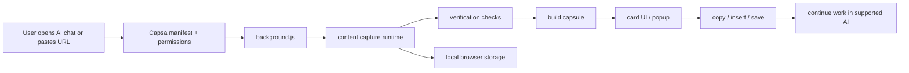

# Capsa

Capsa is a browser extension that helps you save useful AI conversation context, compress it into a portable capsule, and continue the work on another supported AI chat without manually rebuilding everything from memory.

It is designed for the common workflow where a long discussion, design decision, code draft, or research thread is spread across a single chat session or between separate chat tools. Capsa reads the accessible chat content in the browser, validates what it can safely capture, and turns it into a compact text package that can be copied, saved, or inserted into a supported destination.

## Problem statement

AI chats are useful, but they are not always easy to move between sessions, tabs, or tools. A user may hit usage limits, switch from one provider to another, or lose context when a conversation is no longer visible or the current interface is not convenient for continuing the task.

Capsa addresses that problem by making capture and handoff explicit and transparent. It does not promise to recover hidden or unavailable platform data, and it intentionally refuses to produce a capsule when the chat cannot be verified. The extension focuses on the content that is actually accessible in the browser and the supported AI sites it deliberately supports.

## Features

- Verified whole-chat capture for supported AI pages
  - Capsa reads the visible conversation history, follows lazy-loading behavior, and only creates a capsule after independent verification checks agree.
- Link-based capture
  - Paste a supported chat URL and Capsa opens it in a hidden or visible tab, captures it, and closes the page when the work is done.
- Capsule generation and size modes
  - The generated result can be rendered in compact, standard, extended, smart, and full modes depending on the user’s needs and token budget.
- File and folder import safety
  - Text, code, and archive content can be added to the same capsule, while secret-like files, build output, and unsafe paths are skipped or flagged.
- Copy, insert, and export flows
  - The final capsule can be copied to the clipboard, inserted into the active chat textbox, or saved as a Markdown file.
- Local-only processing
  - Capsa stores its working state in the browser and operates without a separate backend service.
- Fallback handling for incomplete reads
  - If the conversation cannot be proven complete, the extension keeps the raw data in a pending state and presents a clear “not verified” path instead of silently producing misleading output.

## How Capsa works

1. The user opens a supported AI conversation or pastes a supported URL.
2. Capsa validates the page or URL and checks whether it is a supported site and a valid chat session.
3. The browser-side reader captures the accessible messages and metadata, including attachment references where available.
4. Capsa verifies the read against the page’s own scrolling and loading behavior before creating a capsule.
5. The user reviews the result, then copies, inserts, exports, or saves it for the next workflow.
6. The user continues the work in another supported AI chat using the generated context.

This workflow is intentionally defensive. If the content is incomplete or the page doesn’t satisfy the validation checks, Capsa refuses to mark it as verified and tells the user exactly why.

## Architecture and data flow

The project is split into a small set of browser-extension layers:

- [background.js](background.js) coordinates capture jobs, background work, link handling, progress reporting, and browser storage.
- [content/capture-runtime.js](content/capture-runtime.js) runs on supported pages to read conversation data and verify that the chat was fully captured.
- [content/launcher.js](content/launcher.js) creates the floating orb or widget used to open the Capsa card.
- [content/share-tap.js](content/share-tap.js) handles share-page readers for supported share links.
- [ui/card.js](ui/card.js) renders the main card UI and orchestrates actions such as capture, verification, copy, and save.
- [ui/popup.html](ui/popup.html) and [ui/popup.js](ui/popup.js) provide the toolbar popup interface.
- [lib/capsule.js](lib/capsule.js) builds the compact payload and renders it in multiple output modes.
- [lib/files.js](lib/files.js) handles file import, zip extraction, secret filtering, and size limits.
- [lib/hosts.js](lib/hosts.js) defines supported AI sites and validates pasted URLs.
- [lib/verify.js](lib/verify.js) enforces the verification logic used to decide whether a full capture is trustworthy.
- [lib/share-rsc.js](lib/share-rsc.js) extracts structured data from share-page payloads.

The actual content capture happens inside the browser on the page being read. Capsa never relies on a remote API for this step; it reads the page state and returns the text, structured records, and metadata the browser exposes to the extension.
